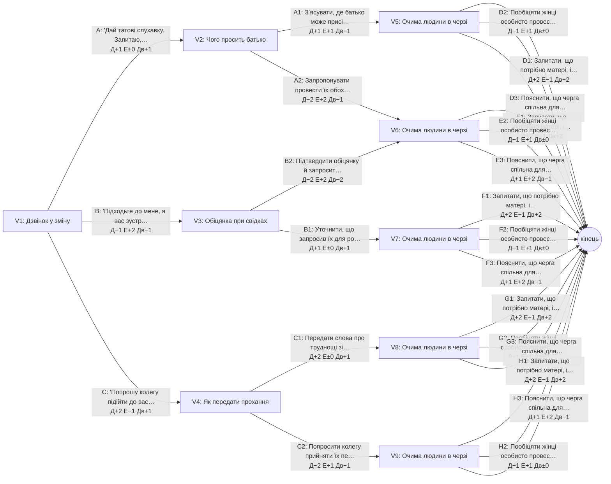
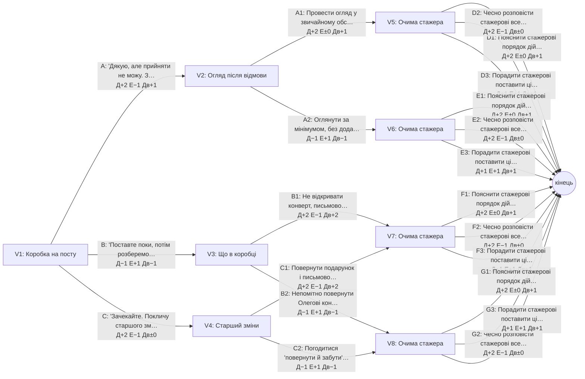
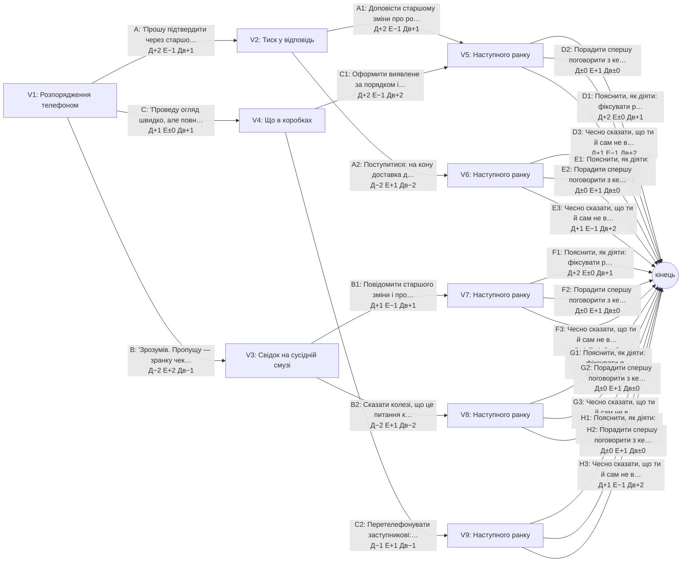

# Сценарії і логіка оцінювання

> Згенеровано `node tools/build.mjs` з `data/stsenarii/*.json`. Не редагуйте вручну — змініть JSON і перезберіть.

## Логіка оцінювання (явні правила, без ШІ)

- Кожен варіант має бали від −2 до +2 за трьома вимірами: **Д** — доброчесність, **Е** — ефективність, **Дв** — довіра (як у форматі організаторів). Поруч — текстове пояснення «чому такі бали».
- Бал за вимір на маршруті = сума балів обраних варіантів. Виміри між собою **не додаються**: загального балу і «правильного» маршруту немає.
- Наслідки двох видів: «одразу» (показується на наступному кроці) і «згодом» (відкладений, у розборі).
- Режим тиску часу: якщо вийшов час, спрацьовує варіант `podacha.inertsiia`, заданий автором; якщо його немає — варіант із найвищою ефективністю, за рівності — з найнижчою доброчесністю (шлях найменшого опору).
- Однакові вибори завжди дають однаковий розбір.

| ID | Назва | Тема | Конфлікт цінностей | Етапів | Маршрутів | Норми | Фахівець ДЗПК | ШІ | Джерело |
|---|---|---|---|---|---|---|---|---|---|
| S06 | Ти ж мене знаєш | konflikt-interesiv | співчуття до людини, якій важко ↔ рівне ставлення до всіх у черзі; відданість давньому знайомому ↔ неупередженість службового рішення | 3 | 18 | ZPK-1, ZPK-3-1-g, NAZK-R4-194, ZPK-28, ZPK-29, ZPK-41, ZPK-22, ZDPSU-23-5, ZPKON-23 | не проведено | так | Сконструйовано командою за мотивами ситуацій №17 (послуга найкращому другові) і №3 (послу… |
| S07 | Це ж від щирого серця | podarunok | ввічливість і добрі стосунки з людьми ↔ неупередженість контролю; згуртованість зміни і лояльність до старшого ↔ правдивість і фіксація | 3 | 18 | ZPK-3-1-g, NAZK-R4-194, ZPK-23, ZPK-24, NAZK-MR2-8, ZPK-22, ZPK-41, ZDPSU-23-5 | не проведено | так | Сконструйовано командою за мотивами ситуації №15 Посібника CIDS (2025): власник ресторану… |
| S08 | Під мою відповідальність | neformalnyi-tysk | субординація і довіра до керівника ↔ законність контролю; швидка допомога фронту ↔ повна перевірка вантажу | 3 | 18 | SVS-30, SVS-36, ZPK-3-1-g, ZPK-44, ZPK-22, ZPK-53-6, ZPK-53-1, ZPK-53-2, ZPK-53-4, ZDPSU-23-5 | не проведено | так | Сконструйовано командою за мотивами ситуацій №19 (поспіх, оформлення «без документів») і… |

## S06. Ти ж мене знаєш

**Роль користувача:** Інспектор прикордонної служби, старший на смузі пропуску. **Аудиторія:** курсанти старших курсів і слухачі ВВНЗ; молоді офіцери Державної прикордонної служби; слухачі курсів підвищення кваліфікації. **Тривалість у груповому режимі:** ≈20 хв.

Черга перед пунктом пропуску довга. Давній знайомий телефонує тобі на особистий номер: його батькові після операції важко стояти, і він уже пообіцяв батькові, що «свій» допоможе пройти швидше. Люди в черзі мають такі самі підстави просити про допомогу, але не мають твого номера.

- **співчуття до людини, якій важко ↔ рівне ставлення до всіх у черзі.** Справедливість на противагу співчуттю (Посібник CIDS, 2025): допомогти літній людині правильно, але допомога, що приходить через знайомство, стає привілеєм.
- **відданість давньому знайомому ↔ неупередженість службового рішення.** Дружні стосунки — приватний інтерес за ст. 1 Закону; він може вплинути на рішення про чергу, навіть якщо потреба справжня.

| Вузол | Варіант | Д | Е | Дв | Чому такі бали | Норми |
|---|---|---|---|---|---|---|
| V1 | **A.** «Дай татові слухавку. Запитаю, що йому потрібно». | +1 | ±0 | +1 | Доброчесність +1: рішення спирається на потребу, а не на знайомство, але канал усе ще особистий. Ефективність 0: допомога ще не надана. Довіра +1: батько відчуває повагу. | ZPK-41 |
| V1 | **B.** «Підходьте до мене, я вас зустріну». | −1 | +2 | −1 | Доброчесність −1: приватний інтерес впливає на порядок черги. Ефективність +2: людині допомогли найшвидше. Довіра −1: інші бачать особливе ставлення. | ZPK-1, ZPK-22, ZPK-41, ZDPSU-23-5 |
| V1 | **C.** «Попрошу колегу підійти до вас і зʼясувати, чим допомогти». | +2 | −1 | +1 | Доброчесність +2: усунення від рішення в умовах потенційного конфлікту. Ефективність −1: забирає час колеги. Довіра +1: рішення ухвалює незалежна людина. | ZPK-28, ZPK-29 |
| V2 | **A1.** Зʼясувати, де батько може присісти, поки син чекає. | +1 | +1 | +1 | Доброчесність +1: черга однакова для всіх. Ефективність +1: справжню потребу задоволено. Довіра +1: рішення можна пояснити будь-кому. | ZPK-41, ZPKON-23 |
| V2 | **A2.** Запропонувати провести їх обох швидше, щоб батько не чекав. | −2 | +2 | −1 | Доброчесність −2: перевага знайомим поза правилом. Ефективність +2: родина пройшла найшвидше. Довіра −1: люди в черзі це бачать. | ZPK-22, ZPK-41, ZDPSU-23-5 |
| V3 | **B1.** Уточнити, що запросив їх для розмови, й запитати батька, яка допомога потрібна. | +1 | ±0 | +1 | Доброчесність +1: обіцянку не підтверджено. Ефективність 0: потреба ще не задоволена. Довіра +1: свідки чують, що правило одне. | ZPK-41 |
| V3 | **B2.** Підтвердити обіцянку й запросити їх пройти наступними. | −2 | +2 | −2 | Доброчесність −2: перевага «своїм» відкрито. Ефективність +2: швидко. Довіра −2: свідки бачили, що черга залежить від знайомств. | ZPK-22, ZPK-41, ZDPSU-23-5 |
| V4 | **C1.** Передати слова про труднощі зі стоянням і попросити поговорити з батьком. | +2 | ±0 | +1 | Доброчесність +2: рішення в незалежних руках. Ефективність 0: потрібен ще один крок. Довіра +1: процес зрозумілий. | ZPK-29 |
| V4 | **C2.** Попросити колегу прийняти їх першими: батько після операції, а ти за нього ручаєшся. | −2 | +1 | −1 | Доброчесність −2: тиск на колегу через приватний інтерес. Ефективність +1: може пришвидшити. Довіра −1: колега і свідки бачать вплив. | ZPK-22, ZPK-28, ZDPSU-23-5 |
| V5 | **D1.** Запитати, що потрібно матері, і пояснити обом родинам, як звернутися по допомогу. | +2 | −1 | +2 | Доброчесність +2: однакове правило для всіх. Ефективність −1: черга чекає. Довіра +2: люди розуміють, як отримати допомогу. | ZPK-41, ZPKON-23 |
| V5 | **D2.** Пообіцяти жінці особисто провести її з матірʼю наступними. | −1 | +1 | ±0 | Доброчесність −1: особиста обіцянка замість правила. Ефективність +1: жінці допомогли. Довіра 0: справедливо для неї, сумнівно для інших. | ZPK-41, ZDPSU-23-5 |
| V5 | **D3.** Пояснити, що черга спільна для всіх, і повернутися до обовʼязків: на смузі ти один. | +1 | +2 | −1 | Доброчесність +1: без винятків. Ефективність +2: смуга працює. Довіра −1: потреба людини лишилася без відповіді. | ZPK-41 |
| V6 | **E1.** Запитати, що потрібно матері, і пояснити обом родинам, як звернутися по допомогу. | +2 | −1 | +2 | Доброчесність +2: однакове правило для всіх. Ефективність −1: черга чекає. Довіра +2: люди розуміють, як отримати допомогу. | ZPK-41, ZPKON-23 |
| V6 | **E2.** Пообіцяти жінці особисто провести її з матірʼю наступними. | −1 | +1 | ±0 | Доброчесність −1: особиста обіцянка замість правила. Ефективність +1: жінці допомогли. Довіра 0: справедливо для неї, сумнівно для інших. | ZPK-41, ZDPSU-23-5 |
| V6 | **E3.** Пояснити, що черга спільна для всіх, і повернутися до обовʼязків: на смузі ти один. | +1 | +2 | −1 | Доброчесність +1: без винятків. Ефективність +2: смуга працює. Довіра −1: потреба людини лишилася без відповіді. | ZPK-41 |
| V7 | **F1.** Запитати, що потрібно матері, і пояснити обом родинам, як звернутися по допомогу. | +2 | −1 | +2 | Доброчесність +2: однакове правило для всіх. Ефективність −1: черга чекає. Довіра +2: люди розуміють, як отримати допомогу. | ZPK-41, ZPKON-23 |
| V7 | **F2.** Пообіцяти жінці особисто провести її з матірʼю наступними. | −1 | +1 | ±0 | Доброчесність −1: особиста обіцянка замість правила. Ефективність +1: жінці допомогли. Довіра 0: справедливо для неї, сумнівно для інших. | ZPK-41, ZDPSU-23-5 |
| V7 | **F3.** Пояснити, що черга спільна для всіх, і повернутися до обовʼязків: на смузі ти один. | +1 | +2 | −1 | Доброчесність +1: без винятків. Ефективність +2: смуга працює. Довіра −1: потреба людини лишилася без відповіді. | ZPK-41 |
| V8 | **G1.** Запитати, що потрібно матері, і пояснити обом родинам, як звернутися по допомогу. | +2 | −1 | +2 | Доброчесність +2: однакове правило для всіх. Ефективність −1: черга чекає. Довіра +2: люди розуміють, як отримати допомогу. | ZPK-41, ZPKON-23 |
| V8 | **G2.** Пообіцяти жінці особисто провести її з матірʼю наступними. | −1 | +1 | ±0 | Доброчесність −1: особиста обіцянка замість правила. Ефективність +1: жінці допомогли. Довіра 0: справедливо для неї, сумнівно для інших. | ZPK-41, ZDPSU-23-5 |
| V8 | **G3.** Пояснити, що черга спільна для всіх, і повернутися до обовʼязків: на смузі ти один. | +1 | +2 | −1 | Доброчесність +1: без винятків. Ефективність +2: смуга працює. Довіра −1: потреба людини лишилася без відповіді. | ZPK-41 |
| V9 | **H1.** Запитати, що потрібно матері, і пояснити обом родинам, як звернутися по допомогу. | +2 | −1 | +2 | Доброчесність +2: однакове правило для всіх. Ефективність −1: черга чекає. Довіра +2: люди розуміють, як отримати допомогу. | ZPK-41, ZPKON-23 |
| V9 | **H2.** Пообіцяти жінці особисто провести її з матірʼю наступними. | −1 | +1 | ±0 | Доброчесність −1: особиста обіцянка замість правила. Ефективність +1: жінці допомогли. Довіра 0: справедливо для неї, сумнівно для інших. | ZPK-41, ZDPSU-23-5 |
| V9 | **H3.** Пояснити, що черга спільна для всіх, і повернутися до обовʼязків: на смузі ти один. | +1 | +2 | −1 | Доброчесність +1: без винятків. Ефективність +2: смуга працює. Довіра −1: потреба людини лишилася без відповіді. | ZPK-41 |

**Норми і застосування.**

- **ZPK-1** (ст. 1; редакція від 23.10.2026, підстава 4903-IX) — Приватний інтерес охоплює дружні та інші позаслужбові стосунки: знайомство з Максимом — саме такий інтерес.
- **ZPK-3-1-g** (пп. «г» п. 1 ч. 1 ст. 3; редакція від 23.10.2026, підстава 4903-IX) — Визначає, на кого поширюються обмеження: військові посадові особи військових формувань. Див. «Застосовність».
- **NAZK-R4-194** (пит. 194 «Хто є військовими посадовими особами?»; публікація від 13.11.2023, позначена на wiki НАЗК як чинна; знімок wiki від 28.09.2026) — Хто є військовою посадовою особою: від цього залежить, чи поширюються ст. 22, 28 на інспектора.
- **ZPK-28** (ч. 1, 3, 5 ст. 28; редакція від 23.10.2026, підстава 4903-IX) — Повідомити безпосереднього керівника про потенційний конфлікт інтересів не пізніше наступного робочого дня і не ухвалювати рішень в умовах реального конфлікту.
- **ZPK-29** (ч. 1 ст. 29; редакція від 23.10.2026, підстава 4903-IX) — Усунення від рішення — передача питання колезі без приватного інтересу.
- **ZPK-41** (ст. 41; редакція від 23.10.2026, підстава 4903-IX) — Вимога діяти неупереджено, незважаючи на особисте ставлення до людей у черзі.
- **ZPK-22** (ч. 1 ст. 22; редакція від 23.10.2026, підстава 4903-IX) — Пропуск поза чергою через знайомство — використання становища для переваги іншим особам.
- **ZDPSU-23-5** (ч. 5 ст. 23; редакція від 28.08.2025, підстава 4196-IX; п. 3 ч. 5 — зі змінами, внесеними законами № 1207-VII від 15.04.2014, № 1664-IX від 15.07.2021) — Спеціальна заборона для прикордонників: під час прикордонного контролю не можна надавати переваги в перетинанні кордону, крім випадків, установлених законами. Знайомство до таких випадків не належить.
- **ZPKON-23** (ч. 2 ст. 23 «Особливості прикордонного контролю окремих категорій осіб»; редакція від 27.06.2026, підстава 3760-IX; абзац про пріоритет додано Законом № 1664-IX від 15.07.2021. Увага: 01.01.2027 набирає чинності нова редакція (підстава 4955-IX) — перед використанням після цієї дати звірити) — Визначає, кому перевага дозволена законом: особам з інвалідністю, які прямують на лікування (з документами), особам з інвалідністю I групи, дітям з інвалідністю та їхнім супровідникам. «Після операції» саме по собі права на пріоритет не дає.

**Застосовність.** Для військовослужбовців ДПСУ під час прикордонного контролю діє спеціальна заборона п. 3 ч. 5 ст. 23 Закону «Про Державну прикордонну службу України»: надавати переваги в перетинанні кордону можна лише у випадках, установлених законами, — їх визначає ст. 23 Закону «Про прикордонний контроль». Старший зміни і начальники за службовим становищем є військовими посадовими особами (NAZK-R4-194), тож обмеження ст. 22, 28 і вимога неупередженості ст. 41 на них поширюються. Чи є таким інспектор на смузі, залежить від його посадових обовʼязків — це питання для фахівця. Сценарій навчає діяти так, ніби обмеження поширюються: це безпечніший варіант. На знайомого, його батька і людей у черзі норми Закону не поширюються. Внутрішній порядок пропуску осіб з особливими потребами в різних підрозділах різний, тому в сценарії він умовний.

**Перевірка змісту.** Фахівець ДЗПК: не проведено. Сценарій переглянув ментор хакатону 19.11.2026: зауважень до змісту немає, запропоновано додати норми ст. 23 ЗУ «Про ДПСУ» і ст. 23 ЗУ «Про прикордонний контроль» (додано). Редакції норм — за переліком організаторів (звірено 10.11.2026); дві додані норми звірено командою з zakon.rada.gov.ua 19.11.2026. Що варто перевірити фахівцю ДЗПК: чи є інспектор на смузі військовою посадовою особою; реалістичність порядку допомоги людям з інвалідністю на пункті пропуску. ШІ: Claude (Anthropic) — Чернетки реплік, варіантів, наслідків, зворотного звʼязку і балів; добір норм-кандидатів із переліку організаторів. Сюжет, варіанти і бали переглядає команда. Цитати й редакції норм — з переліку організаторів, звіреного 10.11.2026.

## S07. Це ж від щирого серця

**Роль користувача:** Інспектор прикордонної служби, старший на огляді вантажів. **Аудиторія:** курсанти старших курсів і слухачі ВВНЗ; молоді офіцери Державної прикордонної служби; слухачі курсів підвищення кваліфікації. **Тривалість у груповому режимі:** ≈20 хв.

Перевізник, якому ти минулого тижня допоміг за правилами виправити помилку в документах, приносить на пост коробку «для всієї зміни»: кава, цукерки — і, як зʼясується, конверт. Його вантажівка сьогодні чекає на твій огляд. Колеги дивляться, а на зміні вперше стажер.

- **ввічливість і добрі стосунки з людьми ↔ неупередженість контролю.** Короткострокова перспектива на противагу довгостроковій (Посібник CIDS, 2025): відмова ображає того, хто щиро вдячний, а прийняття робить «подяку» звичкою, а контроль — залежним від неї.
- **згуртованість зміни і лояльність до старшого ↔ правдивість і фіксація.** «Повернути й забути» береже стосунки в колективі, але не залишає доказів того, що подарунок не взяли.

| Вузол | Варіант | Д | Е | Дв | Чому такі бали | Норми |
|---|---|---|---|---|---|---|
| V1 | **A.** «Дякую, але прийняти не можу. Заберіть, будь ласка». | +2 | −1 | +1 | Доброчесність +2: відмова — перший крок ч. 1 ст. 24. Ефективність −1: стосунки з постійним перевізником напружені. Довіра +1: зміна бачить чітку межу; свідків і письмового повідомлення ще немає. | ZPK-24 |
| V1 | **B.** «Поставте поки, потім розберемося». | −1 | +1 | −1 | Доброчесність −1: подарунок фактично прийнято. Ефективність +1: конфлікту немає, робота йде. Довіра −1: колеги бачать, що «так можна». | ZPK-23, ZPK-24, ZDPSU-23-5 |
| V1 | **C.** «Зачекайте. Покличу старшого зміни, щоб усе було при свідках». | +2 | −1 | ±0 | Доброчесність +2: свідки й керівник — кроки ч. 1 ст. 24. Ефективність −1: затримка і напруга. Довіра 0: процедура прозора, але перевізник ображений. | ZPK-24 |
| V2 | **A1.** Провести огляд у звичайному обсязі й спокійно пояснити, що відмова — правило, а не образа. | +2 | ±0 | +1 | Доброчесність +2: огляд не залежить від подарунка. Ефективність 0: звичайний час. Довіра +1: пояснення зберігає повагу. | ZPK-41 |
| V2 | **A2.** Оглянути за мінімумом, без додаткових перевірок, щоб це не виглядало як помста за коробку. | −1 | +1 | −1 | Доброчесність −1: обсяг огляду залежить від стосунків. Ефективність +1: швидше. Довіра −1: інші водії бачать різницю. | ZPK-22, ZPK-41 |
| V3 | **B1.** Не відкривати конверт, письмово повідомити старшого зміни, колега — свідок. | +2 | −1 | +2 | Доброчесність +2: виконано ч. 2 ст. 24. Ефективність −1: час і настрій зміни. Довіра +2: є доказ, що нічого не взяли. | ZPK-24 |
| V3 | **B2.** Непомітно повернути Олегові конверт, а каву лишити — це дрібниця. | −1 | +1 | −1 | Доброчесність −1: заборону ч. 1 ст. 23 частково порушено, фіксації немає. Ефективність +1: тихо й швидко. Довіра −1: доказів немає. | ZPK-23, ZPK-24, ZDPSU-23-5 |
| V4 | **C1.** Повернути подарунок і письмово зафіксувати пропозицію, як вимагає закон. | +2 | −1 | +2 | Доброчесність +2: усі кроки ч. 1 ст. 24. Ефективність −1: стосунки зі старшим напружені. Довіра +2: випадок задокументовано. | ZPK-24 |
| V4 | **C2.** Погодитися «повернути й забути»: старший зміни знає Олега багато років. | −1 | +1 | −1 | Доброчесність −1: письмового повідомлення немає (ч. 1 ст. 24). Ефективність +1: без конфлікту. Довіра −1: доказів немає. | ZPK-24 |
| V5 | **D1.** Пояснити стажерові порядок дій із закону: відмовитися, залучити свідків, письмово повідомити. | +2 | ±0 | +1 | Доброчесність +2: передано процедуру ст. 24. Ефективність 0: коротка розмова. Довіра +1: стажер знає, що робити. | ZPK-24, NAZK-MR2-8 |
| V5 | **D2.** Чесно розповісти стажерові все — включно з тим, що ти чи старший зміни зробили не так. | +2 | −1 | ±0 | Доброчесність +2: правда без прикрас. Ефективність −1: напруга зі старшим. Довіра 0: стажер довіряє більше, старший — менше. | — |
| V5 | **D3.** Порадити стажерові поставити ці питання уповноваженому з питань запобігання корупції. | +1 | +1 | +1 | Доброчесність +1: правильне джерело відповіді. Ефективність +1: швидко. Довіра +1: процедура працює, хоча особистого прикладу немає. | ZPK-24 |
| V6 | **E1.** Пояснити стажерові порядок дій із закону: відмовитися, залучити свідків, письмово повідомити. | +2 | ±0 | +1 | Доброчесність +2: передано процедуру ст. 24. Ефективність 0: коротка розмова. Довіра +1: стажер знає, що робити. | ZPK-24, NAZK-MR2-8 |
| V6 | **E2.** Чесно розповісти стажерові все — включно з тим, що ти чи старший зміни зробили не так. | +2 | −1 | ±0 | Доброчесність +2: правда без прикрас. Ефективність −1: напруга зі старшим. Довіра 0: стажер довіряє більше, старший — менше. | — |
| V6 | **E3.** Порадити стажерові поставити ці питання уповноваженому з питань запобігання корупції. | +1 | +1 | +1 | Доброчесність +1: правильне джерело відповіді. Ефективність +1: швидко. Довіра +1: процедура працює, хоча особистого прикладу немає. | ZPK-24 |
| V7 | **F1.** Пояснити стажерові порядок дій із закону: відмовитися, залучити свідків, письмово повідомити. | +2 | ±0 | +1 | Доброчесність +2: передано процедуру ст. 24. Ефективність 0: коротка розмова. Довіра +1: стажер знає, що робити. | ZPK-24, NAZK-MR2-8 |
| V7 | **F2.** Чесно розповісти стажерові все — включно з тим, що ти чи старший зміни зробили не так. | +2 | −1 | ±0 | Доброчесність +2: правда без прикрас. Ефективність −1: напруга зі старшим. Довіра 0: стажер довіряє більше, старший — менше. | — |
| V7 | **F3.** Порадити стажерові поставити ці питання уповноваженому з питань запобігання корупції. | +1 | +1 | +1 | Доброчесність +1: правильне джерело відповіді. Ефективність +1: швидко. Довіра +1: процедура працює, хоча особистого прикладу немає. | ZPK-24 |
| V8 | **G1.** Пояснити стажерові порядок дій із закону: відмовитися, залучити свідків, письмово повідомити. | +2 | ±0 | +1 | Доброчесність +2: передано процедуру ст. 24. Ефективність 0: коротка розмова. Довіра +1: стажер знає, що робити. | ZPK-24, NAZK-MR2-8 |
| V8 | **G2.** Чесно розповісти стажерові все — включно з тим, що ти чи старший зміни зробили не так. | +2 | −1 | ±0 | Доброчесність +2: правда без прикрас. Ефективність −1: напруга зі старшим. Довіра 0: стажер довіряє більше, старший — менше. | — |
| V8 | **G3.** Порадити стажерові поставити ці питання уповноваженому з питань запобігання корупції. | +1 | +1 | +1 | Доброчесність +1: правильне джерело відповіді. Ефективність +1: швидко. Довіра +1: процедура працює, хоча особистого прикладу немає. | ZPK-24 |

**Норми і застосування.**

- **ZPK-3-1-g** (пп. «г» п. 1 ч. 1 ст. 3; редакція від 23.10.2026, підстава 4903-IX) — На інспектора й старшого зміни як військових посадових осіб поширюються обмеження ст. 23–24. На стажера-курсанта — ні (див. «Застосовність»).
- **NAZK-R4-194** (пит. 194 «Хто є військовими посадовими особами?»; публікація від 13.11.2023, позначена на wiki НАЗК як чинна; знімок wiki від 28.09.2026) — Хто є військовою посадовою особою.
- **ZPK-23** (ч. 1, 3, 4 ст. 23; редакція від 23.10.2026, підстава 4903-IX) — Подарунок отримано у звʼязку зі службою — він заборонений незалежно від вартості (ч. 1). Рішення на користь дарувальника протягом трьох років вважаються ухваленими в умовах реального конфлікту інтересів (ч. 4) — це стосується й «мʼякшого» огляду.
- **ZPK-24** (ч. 1, 2, 5 ст. 24; редакція від 23.10.2026, підстава 4903-IX) — Порядок дій у разі пропозиції подарунка (ч. 1), якщо його вже виявлено (ч. 2), і в разі сумніву (ч. 5).
- **NAZK-MR2-8** (розд. 8 «Обмеження щодо одержання подарунків» (пп. 8.3–8.5) і п. 14.3 (приклади); розд. 8 і п. 14.3 — публікації від 12.01.2024, позначені на wiki НАЗК як чинні; знімок wiki від 29.09.2026) — Розʼяснення НАЗК про заборонені й дозволені подарунки.
- **ZPK-22** (ч. 1 ст. 22; редакція від 23.10.2026, підстава 4903-IX) — Огляд, полегшений «у відповідь», — використання повноважень на користь іншої особи, навіть якщо коробку не взяли.
- **ZPK-41** (ст. 41; редакція від 23.10.2026, підстава 4903-IX) — Однаковий обсяг огляду для всіх незалежно від особистого ставлення.
- **ZDPSU-23-5** (ч. 5 ст. 23; редакція від 28.08.2025, підстава 4196-IX; п. 3 ч. 5 — зі змінами, внесеними законами № 1207-VII від 15.04.2014, № 1664-IX від 15.07.2021) — Спеціальна заборона для прикордонників: під час прикордонного контролю не можна приймати будь-які предмети (речі) від будь-яких осіб — навіть каву «для зміни».

**Застосовність.** Для військовослужбовців ДПСУ під час прикордонного контролю діє ще й спеціальна заборона п. 1 ч. 5 ст. 23 Закону «Про Державну прикордонну службу України»: приймати будь-які предмети (речі) від будь-яких осіб. Обмеження ст. 23–24 поширюються на інспектора і старшого зміни як військових посадових осіб (якщо їхні обовʼязки відповідають NAZK-R4-194 — це має підтвердити фахівець). На перевізника норми Закону не поширюються: пропонуючи «подяку», він не порушує ст. 23, але ставить посадову особу в ситуацію, де прийняття є порушенням. Стажер-курсант не є субʼєктом пп. «г» п. 1 ч. 1 ст. 3, тому розмова з ним — про навчання, а не про його відповідальність. Розмір санкцій (KUPAP-172-5 не звірено) у сценарії не наводиться.

**Перевірка змісту.** Фахівець ДЗПК: не проведено. Сценарій переглянув ментор хакатону 19.11.2026: зауважень до змісту немає, запропоновано додати норми ст. 23 ЗУ «Про ДПСУ» і ст. 23 ЗУ «Про прикордонний контроль» (додано). Редакції норм — за переліком організаторів (звірено 10.11.2026); дві додані норми звірено командою з zakon.rada.gov.ua 19.11.2026. Що варто перевірити фахівцю ДЗПК: застосовність ст. 23–24 до інспектора; реалістичність порядку огляду і фіксації подарунка на пункті пропуску. ШІ: Claude (Anthropic) — Чернетки реплік, варіантів, наслідків, зворотного звʼязку і балів; добір норм-кандидатів із переліку організаторів. Сюжет, варіанти і бали переглядає команда. Цитати й редакції норм — з переліку організаторів, звіреного 10.11.2026.

## S08. Під мою відповідальність

**Роль користувача:** Інспектор прикордонної служби, старший на огляді вантажів. **Аудиторія:** курсанти старших курсів і слухачі ВВНЗ; молоді офіцери Державної прикордонної служби; слухачі курсів підвищення кваліфікації. **Тривалість у груповому режимі:** ≈25 хв.

Уночі на вантажний термінал заїжджає мікроавтобус із коробками «гуманітарна допомога для бригади». Документів на частину вантажу немає, водій обіцяє, що їх «довезуть зранку». Заступник начальника телефонує тобі напряму, в обхід старшого зміни, і просить пропустити «під його відповідальність».

- **субординація і довіра до керівника ↔ законність контролю.** Правда на противагу відданості (Посібник CIDS, 2025): відмовити керівникові ризиковано, а виконати усне розпорядження в обхід порядку означає взяти на себе те, за що «відповідальність» обіцяли лише на словах.
- **швидка допомога фронту ↔ повна перевірка вантажу.** Короткострокова перспектива на противагу довгостроковій: затримка шкодить меті, але неперевірений «гуманітарний» вантаж підриває довіру до всієї допомоги.

| Вузол | Варіант | Д | Е | Дв | Чому такі бали | Норми |
|---|---|---|---|---|---|---|
| V1 | **A.** «Прошу підтвердити через старшого зміни або письмово. Без цього оформлю все за порядком». | +2 | −1 | +1 | Доброчесність +2: порядок дотримано без відмови від субординації. Ефективність −1: затримка. Довіра +1: розмова стала прозорою. | ZPK-44, SVS-30 |
| V1 | **B.** «Зрозумів. Пропущу — зранку чекаю документи». | −2 | +2 | −1 | Доброчесність −2: пропуск без документів за усною вказівкою. Ефективність +2: вантаж поїхав одразу. Довіра −1: рішення неможливо пояснити документами. | SVS-30, SVS-36, ZPK-22, ZDPSU-23-5 |
| V1 | **C.** «Проведу огляд швидко, але повністю. Відсутні документи зафіксую». | +1 | ±0 | +1 | Доброчесність +1: перевірку проведено, але розпорядження не задокументовано. Ефективність 0: затримка невелика. Довіра +1: факти зафіксовано. | ZPK-44 |
| V2 | **A1.** Доповісти старшому зміни про розпорядження й діяти за встановленим порядком. | +2 | −1 | +1 | Доброчесність +2: доповідь за підпорядкованістю. Ефективність −1: вантаж стоїть. Довіра +1: рішення не залежить від тиску. | ZPK-44, ZPK-53-4 |
| V2 | **A2.** Поступитися: на кону доставка для фронту, а керівник бере відповідальність на себе. | −2 | +1 | −2 | Доброчесність −2: виконано доручення всупереч порядку. Ефективність +1: вантаж поїхав. Довіра −2: погроза спрацювала. | SVS-36, ZPK-22, ZDPSU-23-5 |
| V3 | **B1.** Повідомити старшого зміни і про пропуск без огляду, і про телефонне розпорядження. | +1 | −1 | +1 | Доброчесність +1: чесно, але після пропуску. Ефективність −1: вантаж уже не повернути. Довіра +1: дзвінок задокументовано. | ZPK-53-6 |
| V3 | **B2.** Сказати колезі, що це питання керівництва: розпорядження дав заступник, не ти. | −2 | +1 | −2 | Доброчесність −2: порушення приховано. Ефективність +1: зміна працює далі. Довіра −2: колега бачить, що правила вибіркові. | ZPK-53-6 |
| V4 | **C1.** Оформити виявлене за порядком і письмово доповісти, зокрема про дзвінок. | +2 | −1 | +2 | Доброчесність +2: виявлене оформлено, дзвінок задокументовано. Ефективність −1: ніч на оформлення. Довіра +2: повна картина зафіксована. | ZPK-53-6, ZPK-53-1 |
| V4 | **C2.** Перетелефонувати заступникові: можливо, він знає щось, чого не знаєш ти. | −1 | +1 | −1 | Доброчесність −1: рішення віддано тому, хто тисне. Ефективність +1: можливо, швидше. Довіра −1: слідів погодження немає. | ZPK-44 |
| V5 | **D1.** Пояснити, як діяти: фіксувати розпорядження, доповідати за підпорядкованістю, знати про внутрішні канали повідомлення. | +2 | ±0 | +1 | Доброчесність +2: передано процедуру й канали. Ефективність 0: розмова. Довіра +1: напарник знає про захист. | ZPK-53-1, ZPK-53-2, ZPK-53-4 |
| V5 | **D2.** Порадити спершу поговорити з керівником напряму — і лише потім писати. | ±0 | +1 | ±0 | Доброчесність 0: не порушення, але й не захист. Ефективність +1: менше конфліктів. Довіра 0: усе залежить від доброї волі керівника. | SVS-30 |
| V5 | **D3.** Чесно сказати, що ти й сам не впевнений, чи вчинив правильно. | +1 | −1 | +2 | Доброчесність +1: правдивість. Ефективність −1: інструменту немає. Довіра +2: відкритість у команді. | — |
| V6 | **E1.** Пояснити, як діяти: фіксувати розпорядження, доповідати за підпорядкованістю, знати про внутрішні канали повідомлення. | +2 | ±0 | +1 | Доброчесність +2: передано процедуру й канали. Ефективність 0: розмова. Довіра +1: напарник знає про захист. | ZPK-53-1, ZPK-53-2, ZPK-53-4 |
| V6 | **E2.** Порадити спершу поговорити з керівником напряму — і лише потім писати. | ±0 | +1 | ±0 | Доброчесність 0: не порушення, але й не захист. Ефективність +1: менше конфліктів. Довіра 0: усе залежить від доброї волі керівника. | SVS-30 |
| V6 | **E3.** Чесно сказати, що ти й сам не впевнений, чи вчинив правильно. | +1 | −1 | +2 | Доброчесність +1: правдивість. Ефективність −1: інструменту немає. Довіра +2: відкритість у команді. | — |
| V7 | **F1.** Пояснити, як діяти: фіксувати розпорядження, доповідати за підпорядкованістю, знати про внутрішні канали повідомлення. | +2 | ±0 | +1 | Доброчесність +2: передано процедуру й канали. Ефективність 0: розмова. Довіра +1: напарник знає про захист. | ZPK-53-1, ZPK-53-2, ZPK-53-4 |
| V7 | **F2.** Порадити спершу поговорити з керівником напряму — і лише потім писати. | ±0 | +1 | ±0 | Доброчесність 0: не порушення, але й не захист. Ефективність +1: менше конфліктів. Довіра 0: усе залежить від доброї волі керівника. | SVS-30 |
| V7 | **F3.** Чесно сказати, що ти й сам не впевнений, чи вчинив правильно. | +1 | −1 | +2 | Доброчесність +1: правдивість. Ефективність −1: інструменту немає. Довіра +2: відкритість у команді. | — |
| V8 | **G1.** Пояснити, як діяти: фіксувати розпорядження, доповідати за підпорядкованістю, знати про внутрішні канали повідомлення. | +2 | ±0 | +1 | Доброчесність +2: передано процедуру й канали. Ефективність 0: розмова. Довіра +1: напарник знає про захист. | ZPK-53-1, ZPK-53-2, ZPK-53-4 |
| V8 | **G2.** Порадити спершу поговорити з керівником напряму — і лише потім писати. | ±0 | +1 | ±0 | Доброчесність 0: не порушення, але й не захист. Ефективність +1: менше конфліктів. Довіра 0: усе залежить від доброї волі керівника. | SVS-30 |
| V8 | **G3.** Чесно сказати, що ти й сам не впевнений, чи вчинив правильно. | +1 | −1 | +2 | Доброчесність +1: правдивість. Ефективність −1: інструменту немає. Довіра +2: відкритість у команді. | — |
| V9 | **H1.** Пояснити, як діяти: фіксувати розпорядження, доповідати за підпорядкованістю, знати про внутрішні канали повідомлення. | +2 | ±0 | +1 | Доброчесність +2: передано процедуру й канали. Ефективність 0: розмова. Довіра +1: напарник знає про захист. | ZPK-53-1, ZPK-53-2, ZPK-53-4 |
| V9 | **H2.** Порадити спершу поговорити з керівником напряму — і лише потім писати. | ±0 | +1 | ±0 | Доброчесність 0: не порушення, але й не захист. Ефективність +1: менше конфліктів. Довіра 0: усе залежить від доброї волі керівника. | SVS-30 |
| V9 | **H3.** Чесно сказати, що ти й сам не впевнений, чи вчинив правильно. | +1 | −1 | +2 | Доброчесність +1: правдивість. Ефективність −1: інструменту немає. Довіра +2: відкритість у команді. | — |

**Норми і застосування.**

- **SVS-30** (ст. 30; редакція від 18.03.2026, підстава 4797-IX) — Накази виконуються беззастережно, крім явно злочинних. Чи є усне «пропусти без документів» таким — питання для обговорення.
- **SVS-36** (ст. 36; редакція від 18.03.2026, підстава 4797-IX) — Командир відповідає за відданий наказ і його відповідність законодавству. Але підпис під пропуском ставить інспектор.
- **ZPK-3-1-g** (пп. «г» п. 1 ч. 1 ст. 3; редакція від 23.10.2026, підстава 4903-IX) — Інспектор і заступник начальника як військові посадові особи — субʼєкти Закону.
- **ZPK-44** (ч. 1, 3 ст. 44; редакція від 23.10.2026, підстава 4903-IX) — Посадові особи утримуються від виконання доручень керівництва, що суперечать закону, і повідомляють про це.
- **ZPK-22** (ч. 1 ст. 22; редакція від 23.10.2026, підстава 4903-IX) — Заборона використовувати становище для неправомірної вигоди іншим стосується і того, хто телефонує, і того, хто виконує.
- **ZPK-53-6** (ч. 6 ст. 53; редакція від 23.10.2026, підстава 4903-IX) — Посадова особа, що виявила корупційне правопорушення, мусить вжити заходів і протягом 24 годин письмово повідомити уповноважений субʼєкт.
- **ZPK-53-1** (ч. 1, 2 ст. 53-1; редакція від 23.10.2026, підстава 4903-IX) — Внутрішні канали повідомлення, зокрема анонімні.
- **ZPK-53-2** (ч. 1 ст. 53-2; редакція від 23.10.2026, підстава 4903-IX) — Канал повідомлення викривач обирає сам: внутрішній, регулярний чи зовнішній.
- **ZPK-53-4** (ч. 1 ст. 53-4; редакція від 23.10.2026, підстава 4903-IX) — Заборонено негативні заходи впливу через повідомлення.
- **ZDPSU-23-5** (ч. 5 ст. 23; редакція від 28.08.2025, підстава 4196-IX; п. 3 ч. 5 — зі змінами, внесеними законами № 1207-VII від 15.04.2014, № 1664-IX від 15.07.2021) — Під час прикордонного контролю прикордонникам заборонено надавати переваги в перетинанні кордону особам, транспортним засобам і вантажам, крім випадків, установлених законами. «Гуманітарний» статус без документів таким випадком не є.

**Застосовність.** Інспектор, старший зміни і заступник начальника — військові посадові особи (NAZK-R4-194; для інспектора залежить від обовʼязків — перевірити фахівцю). Статут внутрішньої служби ЗСУ наведено як орієнтир щодо наказів; чи поширюється він на конкретне військове формування і чи є усне розпорядження «наказом» у сенсі ст. 30, сценарій свідомо не вирішує — це питання для обговорення і фахівця. Що вантаж є предметом корупційного правопорушення, на початку невідомо: обовʼязок ч. 6 ст. 53 виникає, коли порушення виявлено. Митні й прикордонні процедури оформлення вантажу в сценарії умовні.

**Перевірка змісту.** Фахівець ДЗПК: не проведено. Сценарій переглянув ментор хакатону 19.11.2026: зауважень до змісту немає, запропоновано додати норми ст. 23 ЗУ «Про ДПСУ» і ст. 23 ЗУ «Про прикордонний контроль» (додано). Редакції норм — за переліком організаторів (звірено 10.11.2026); дві додані норми звірено командою з zakon.rada.gov.ua 19.11.2026. Що варто перевірити фахівцю ДЗПК: застосовність Статуту внутрішньої служби ЗСУ і ст. 44 у цьому формуванні; формулювання щодо наказу; реалістичність оформлення вантажу без документів. ШІ: Claude (Anthropic) — Чернетки реплік, варіантів, наслідків, зворотного звʼязку і балів; добір норм-кандидатів із переліку організаторів. Сюжет, варіанти і бали переглядає команда. Цитати й редакції норм — з переліку організаторів, звіреного 10.11.2026.
